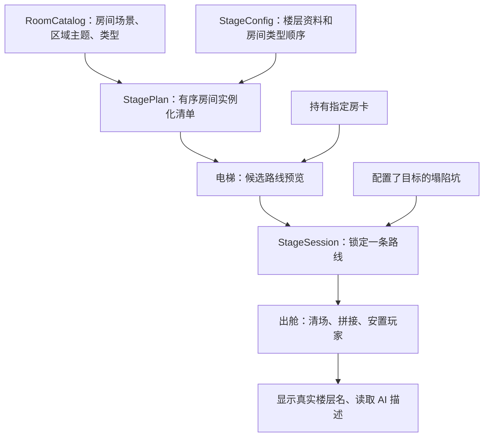
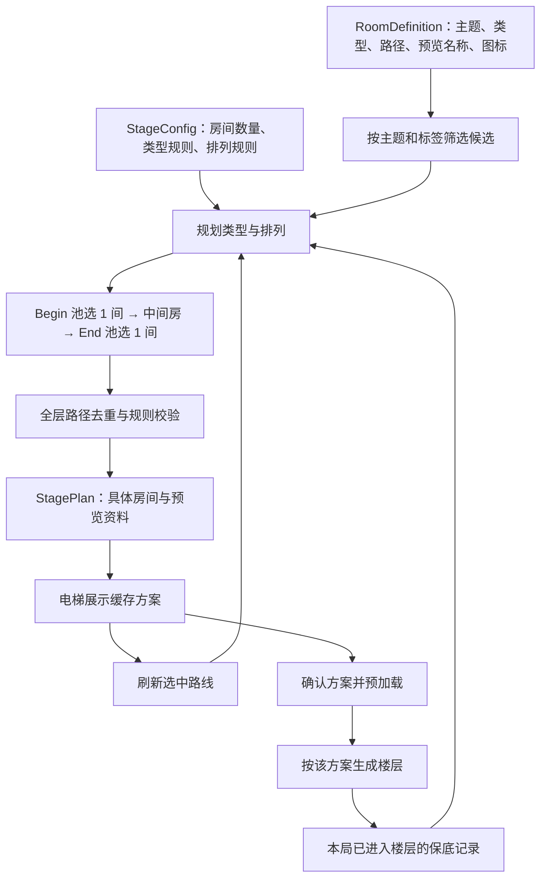

# 酒店楼层、路线预览与隐藏入口

## 运行结构

- 在 `resources/stages/hotel_room_catalog.tres` 添加房间资料。房间场景根节点继续使用现有的 `AreaSize`、相机区域和出生点约定。
- 在 `StageConfig` 设置 `FloorTheme` 和 `RoomSequence`。例如 `Begin → Combat → Combat → EliteCombat → Boss`。Boss 和出口同场时只写一个 Boss。独立出口使用 `Exit`。
- 当前 B/C/D 房间按旧池迁移。Easy、Normal、Hard 分别映射为 `Combat`、`AdvancedCombat`、`EliteCombat`。F 层固定拼接一阶段、左翼、中枢、右翼和退场。左右翼按角色池选择，当前各有一个候选。中枢为 F_boss_core，电梯预览仅显示 Boss。新增侧翼变体时，应沿用 F_boss_left 或 F_boss_right 运行时角色路径及现有轨道接缝尺寸。E 层与谜题房等新内容可按相同约定入库。
- 每份路线按实际场景资源路径在整层去重，入口、各玩法房与终点一起计算。候选交叉时可以重新分配已选位置。无法得到完整排列时，该路线不出现在电梯选项。
- 初次打开电梯选关时为候选路线生成并缓存方案。同一个来源楼层反复打开时复用方案。出舱后只实例化所选方案中的房间。目录和候选方案只保存场景路径与顺序。确认路线时只后台加载选中的房间，失败可重选。
- 当前电梯沿用数字键测试选关，每行显示一条路线。出发提示读 `ElevatorLabel`，为空显示 `？？？`。出舱、房间生成成功后，标题读 `DisplayName`。AI 快照读当前楼层的 `LevelDescription`。楼层难度仍由 `stage_difficulty` 和 `DifficultyOverride` 计算。

## 隐藏楼层

1. 新建 `StageConfig`，启用 `IsHiddenFloor`，配置楼层资料、主题与路线，加入 `StageSession.AllConfigs`。
2. 房卡入口使用 `RequiredRoomKeyItemId` 关联物品 ID。背包、快捷栏或专用装备槽持有该 ID 时，电梯显示对应隐藏路线。也可以设置 `RequiredStoryFlag`，或通过 `UnlockHiddenFloor()` 授予资格。房卡默认保留。
3. 塌陷入口使用 `FallRegion.HiddenFloorDestinations`。在需要作为入口的深坑中填入候选隐藏楼层。坠落开始时从有效候选中随机选择一层并后台加载。动画结束且资源就绪后提交，超时走普通坠落回退。换层接管玩家传送，普通坠落回退和扣血不执行。目标为空或无法生成时执行原坠落流程。
4. 当前隐藏楼层出口根据来源楼层推导下一站。返回原楼层并保留清怪、拾取、机关状态需要另行接入房间状态保存。隐藏楼层可以再次进入，是否限制访问由入口规则决定。

现有 `stage_eggA.tres` 已迁移为隐藏楼层，房卡资源为 `RoomKey_HiddenA.tres`。测试可通过 F3 解锁，具体关卡中的房卡掉落和塌陷点位由关卡配置决定。F 层正式条件分支的目标和剧情条件仍需内容配置。

可将房卡场景 scenes/items/room_key_hidden_a.tscn 放入房间或用作掉落。

- Stage_home 使用 StandaloneStage 配置启动路线。Stage_2、Stage_3、Stage_4 和 Stage_test 的独立场景已移除。酒店由 StageSession 提交路线。生成器与配置资源均已移除旧五池和房间数量字段。

普通路线当前使用 RandomMiddleRooms，按 FloorTheme 筛选战斗、战斗+、战斗++、谜题、商店、治疗中间房。MiddleRoomRouteTag 可选，填写时进一步筛选 RouteTags。BeginScenePath 和 EndScenePath 当前仍为固定路径。Ordered 模式使用 RoomSequence。

## 下一轮实施计划（2026-11-17）

本节原实施清单已完成首尾池、名称与图标预览、类型规则、刷新和会话内保底。当前具体配置与边界见下方“实施后的配置”。涉及最终行为时，以本节替代前文旧的首尾房和预览约定。

### 目标结构

### 1. 先调整基础资源与兼容规则

- 修改 RoomType.cs，将 Exit = 6 改名为 End = 6。保留所有已有数字值，包括 Boss = 5，避免旧资源的枚举值发生偏移。枚举总数仍为 13。
- 修改 RoomDefinition.cs，新增 ElevatorPreviewName，继续使用 ElevatorPreviewIcon。类型决定生成位置和筛选，预览名称描述该具体房间。
- 结束房可以配置 RoomType = End、ElevatorPreviewName = “Boss”或具体 Boss 名、ElevatorPreviewIcon = 对应 Boss 图标。Begin 和普通房间也支持各自的名称与图标。
- 清点所有 Exit 代码引用、RoomSequence、房间目录以及预览文字映射。检查字符串形式的旧类型数据是否需要兼容读取。

### 2. 迁移房间目录与首尾房配置

- 修改 hotel_room_catalog.tres，把 B_end、C_end、D_end 及其他普通楼层结束房改为 End，并填写对应预览名称。逐一核对 A_end、E/F 及隐藏楼层的用途。
- 为同一 FloorTheme 的不同入口和终点各建一份 RoomDefinition，类型分别为 Begin、End，允许多个候选。
- StageConfig 的普通随机模式采用 Begin 池和 End 池，逐步迁移固定 BeginScenePath、EndScenePath。先确保旧路径都已入库、能形成等价候选，再删除字段及各 tres 中的旧赋值。
- MiddleRoomRouteTag 继续只约束中间房。首尾池默认按 FloorTheme 和类型筛选，未来若需要区域专属首尾房，再增加明确的筛选配置。
- Ordered 模式继续按 RoomSequence 规划，包括 Stage_home 与 F 层特殊组合。逐份核对末尾类型，避免迁移 End 后导致 Ordered 路线候选为空。
- F 层保持 F_begin → 随机左翼 → F_boss_core → 随机右翼 → F_end 的组合和运行时角色路径。F 层的电梯汇总预览继续使用中枢的预览资料。

### 3. 增加可控随机规则资源

- 建议新增 RoomTypeRule.cs 资源，由 StageConfig 持有规则列表。每项设置 RoomType、Weight、MinCount、MaxCount，用于本路线中间房。
- 无规则的旧配置继续使用现有随机行为。配置规则后，先满足最低数量，再按权重填满剩余名额，并遵守最高数量。
- 在实现前确定字段语义，例如 MaxCount = -1 表示仅受 MiddleRoomCount 限制，0 表示禁止该类型。编辑器注释必须说明。
- 校验 MinCount 总和、MiddleRoomCount、可用独立场景数量，以及各类型上下限，候选为空的类型不能参与抽取。无法满足时报告具体配置原因。
- 排列规则先支持限制同类型连续数量。复杂的位置限制在明确内容需求后添加，避免提前堆积字段。
- 权重按类型计算，再从对应类型中抽具体房间，避免一种类型因美术变体数量多而获得额外概率。

### 4. 更新 StageGeneratorManager.CreatePlan

- 普通路线先从当前主题的 Begin 池选首位、End 池选末位，中间位置按第 3 步规则生成。
- 类型数量、顺序和具体场景选择都使用同一次规划的随机源。
- 全部位置按实际场景路径去重，包括首尾。沿用当前候选重分配能力，避免贪心选择造成后续无房可选。
- 类型规划也必须检查剩余候选容量，需要时回溯或有限重试。达到限制仍失败则返回明确的失败结果，禁止无界重抽。
- 固定种子支持复现，后续刷新通过新的刷新序号派生种子，不能每次重复使用同一个固定种子生成相同结果。

### 5. 更新 StagePlan 与电梯展示

- StagePlan 保存本次选中的路径、类型、预览名称和图标，生成后保持稳定。可采用一个有序房间条目列表，减少多个平行列表错位的风险。
- 预览优先显示房间图标，无图标时显示 ElevatorPreviewName。名称留空时回退到类型文字，兼容未配置资料。
- Boss 类型房间与 End 类型房间都可显示 Boss 名称或 Boss 图标。
- 隐藏楼层仍按当前规则显示“？？？”，F 层仍汇总为中枢预览。楼层标题 DisplayName 和出发提示 ElevatorLabel 继续由各自字段控制。
- 确认、预加载、实际生成必须引用同一份 StagePlan，禁止出舱时重新随机。

### 6. 电梯刷新选中路线

- StageSession 提供刷新选中候选方案的方法，电梯面板增加刷新操作，成功后更新对应路线预览。
- 新方案生成成功后才替换 _candidatePlans 和 _displayedPlans 中对应项。失败时保留旧方案，并给出可理解的提示。
- 刷新会更换具体房间、类型和排列，仍遵守首尾池、数量、去重、保底和排列规则。
- 为候选方案增加版本或身份检查，使旧方案的异步预加载结果不能覆盖新方案。已开始提交换层时禁用刷新。
- 重新打开面板继续使用缓存。只有显式刷新才重新抽取。刷新次数、费用、是否保证与旧路线不同属于待确认的产品规则。
- 当前回合可先实现类型规则和刷新，再加入跨楼层保底。

### 7. 跨楼层保底

- 在本局运行状态中记录各目标类型连续缺席的有效楼层数，并提供可配置阈值。达到阈值后，至少一条候选路线包含对应类型。
- 计数只在玩家成功进入新楼层后更新。预览、刷新、加载失败和反复开关面板不增加计数、不清除保底。
- 玩家进入含目标类型的路线后才清除该类型计数。选择其他路线后，保底保持待满足。
- 缺少该类型候选、F 层固定 Boss 结构及其他明确不参与规则的楼层，不计入有效缺席楼层。隐藏楼层是否参与需要明确配置策略。
- 刷新承担保底的路线时必须重新保证候选集合仍有保底选项。多个保底同时到期时，检查路线容量，明确优先级与未满足项的保留方式。
- 若本局支持中途存档，需要一并保存保底计数、随机种子与刷新序号，并核对候选缓存恢复策略。

### 8. 验证与清理

1. 同一主题配置多个 Begin/End，验证首尾池均可被抽到，首尾类型正确，整层无重复路径。
2. 验证 End 房在电梯显示具体 Boss 名或图标，未填写预览资料时正常回退。
3. 验证数量上下限、零权重、空候选、房间数量不足及冲突规则，失败信息能指出问题。
4. 验证刷新成功、刷新失败、连续刷新和预加载期间刷新，确认预览与实际房间一致。
5. 验证保底只随成功进入有效楼层更新，并且刷新、重开面板不会绕过保底。
6. 验证 Stage_home、F 层三房联动与隐藏入口仍可正确生成和切换。
7. 编译与必要的运行检查完成后，删除临时测试场景和本次产生的临时日志。

主要修改脚本为 RoomType.cs、RoomDefinition.cs、StageConfig.cs、StagePlan.cs、StageGeneratorManager.cs、StageSession.cs，以及实际电梯面板脚本。新增规则资源与保底运行数据应在相应步骤落地时确定最终名称。迁移资源涵盖 hotel_room_catalog.tres、所有受影响 StageConfig 和电梯 UI 场景。

## 实施后的配置（2026-11-17）

- 普通随机路线使用当前主题的 Begin / End 房池。B/C/D 的结束房均已迁移为 End，预览名设为 Boss；stage_1 的 Ordered 末尾也已迁移为 6。固定首尾路径字段已删除。
- RoomDefinition.ElevatorPreviewName 填写具体房间名，ElevatorPreviewIcon 填写图标；优先显示图标，文字名兼作提示，无图标时使用文字，空名称回退类型名。
- StageConfig.MiddleRoomRules 可添加 RoomTypeRule。Weight 控制类型抽取权重，MinCount 为最低数量，MaxCount 为上限（-1 不额外限制，0 禁止），GuaranteeAfter 为连续缺席有效楼层数（0 禁用）。未配置的类型在有规则时默认权重 1、最少 0、无额外上限。权重 0 仍可满足最低数量或到期保底。
- MaxConsecutiveRoomType = 0 表示不限制。正数限制连续同类型中间房数量。
- 规则列表为空时按各类型剩余具体房间数量加权，延续旧配置的房间池抽取倾向。现有路线未擅自填入新的概率、最低数量或保底阈值，可在 Inspector 中按关卡设计设置。
- 电梯面板提供“刷新选中路线”。目前免费且不限次数，允许随机得到相同方案；仅 RandomMiddleRooms 可刷新。Ordered 与特殊固定结构不可刷新。失败保留原方案。
- 刷新成功会清空待提交方案和加载任务引用，旧异步加载仍可完成，但结果不会被作为新路线提交。已提交换层期间拒绝刷新。
- 保底计数在 StageGenerated 成功后更新，仅统计有对应候选且允许该类型的普通随机楼层。隐藏和 Ordered 楼层不计入。当前按每条配置的规则分别保证，各符合条件的候选路线都会尝试满足到期保底；同时到期优先缺席更久的类型，数量不足时其余计数继续保留。
- 当前保底与刷新序号由 StageSession 持有，生命周期为一次酒店会话。现有 GameSaveData 没有恢复酒店当前楼层和候选路线的中途续局数据，因此没有把本局保底混入永久进度。以后增加完整中途续局时需一起保存当前路线、候选方案、种子、刷新序号和保底计数。
- 新增 RoomTypeRule.cs 与 RoomRoutePlanner.cs。预览资料目前沿用 StagePlan 的平行只读列表并增加 RoomNames，由同一批选中路径统一构造。
- C# 编译通过。尚需 Godot 内验证电梯交互、实际房间拼接和长流程保底行为。未创建临时测试场景或日志文件。